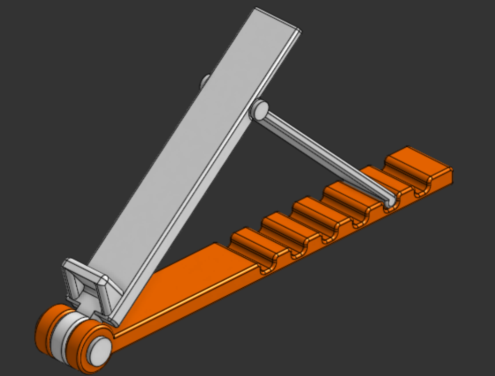
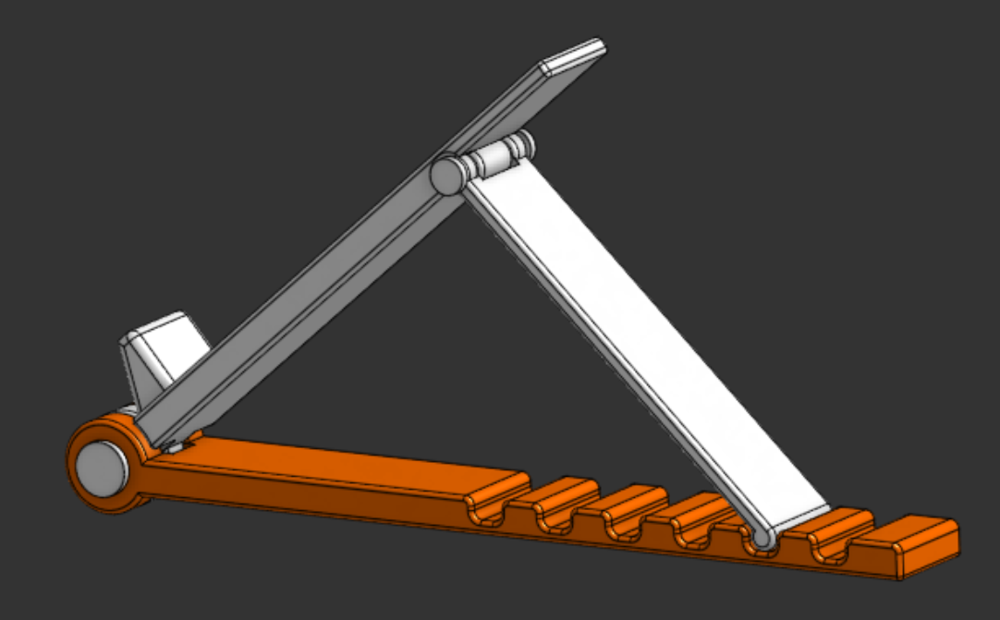

# laptop-stand
An ergonomic, adjustable, and portable laptop stand designed for better cooling and posture.

## What is this?
The Laptop Stand is a very compact, adjustable, and sleek mount for your laptop. This design is done in Onshape from scratch and has 6 adjustable inclines for your laptop. It shares colors with my other Organizer projects, i.e., orange and white. It is very sturdy and can serve a variety of laptop sizes. Being lightweight, this stand is also travel-friendly and cheap to print, so if it breaks due to a mishap, you can print it again. This stand is 25mm (2.5 cm) wide and therefore has direct contact with a relatively large area of the laptop, which makes it usable on a variety of surfaces, though it is recommended to be placed on a plain desk or table.





## Repository Structure
```text
laptop-stand/
1] Assets/----> All the images and visual references of the project
2] Hardware/--> Source design files (.step)
3] BOM.csv----> Bill of materials
4] LICENSE----> MIT License
5] README.md --> Detailed project documentation and instructions
```

## Live 3d view in Onshape
Click [here](https://cad.onshape.com/documents/1e385fa37b7561cb39ad7471/w/bd9d94415eb58f7ebe38279c/e/479a54bf6495c5849700ca54) to view Laptop Stand in Onshape!

## How to get your own Laptop Stand?
1. Download the source CAD .step files from the [Hardware](Hardware/) directory
2. Import the file into your CAD editor and make edits as you want (Optional)
3. Go to your fabricater/ manufacturer website, get a quote, and purchase it (For Example, [ROBU](https://robu.in) or [JLCPCB](https://jlcpcb.com)) (Don't forget to get the prints twice to make a pair of a single laptop stand)
4. Wait for it to arrive
5. You will need superglue while assembling the stand
6. As seen in the image, place the parts (You may need to slightly sand the parts first): Base, Support Arm, and Holder
7. Further, as seen in the image highlighted by different colors, insert the locking stems and stick them with superglue
8. This will make your stand usable and assembled for your laptop
9. That's it! Go enjoy your Laptop!

## [BOM](BOM.csv) as a table
| Item     | Description   | Quantity | Price (USD) | Link                             |
|----------|---------------|----------|-------------|----------------------------------|
| 3D print | PLA (~200 gm) | 1        | 8.5         | https://printlegion.hackclub.com |
| Shipping |               |          | 1           |                                  |
| Total    |               |          | 9.5         |                                  |

## Fabrication Specs
1. Printer- 0.2 mm Standard Quality
2. Material- PLA
3. Color- Orange & White
4. Infill- 40-50%

## License
[MIT](LICENSE)- Use, modify, share as you like!

## Notes
- If ya'll like this project, make sure to see my other projects [Hold 90](https://github.com/vd-sh/hold-90), [Tab Mount](https://github.com/vd-sh/tab-mount), or [Book Stand](https://github.com/vd-sh/book-stand)
- Or simply visit my [profile](https://github.com/vd-sh) to see the latest projects :)
